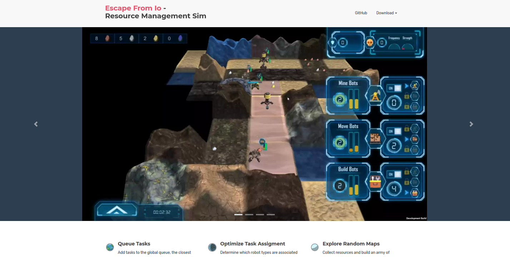

<div align="center">
  <a href="https://justinlycklama.github.io/Escape-From-Io/"></a>

<a href="https://justinlycklama.github.io/Escape-From-Io/">Github Pages</a>
</div>

# Escape From Io

An indirect-control RTS. You're stranded on Io with a few battery-powered robots. You don't steer them: you queue work (mine this rock,
build that tower), and they pull jobs from per-type queues. Keep building robots before the batteries run out, survive the Rock Golems,
and build the escape shuttle.

Built 2019–2020 (v0.2, mobile). Revived in 2026 as a **PC-only** project on **Unity 6000.3.28f1 LTS**.

## Getting started

1. Install **Unity 6000.3.28f1** (Unity Hub) and the **Unity CLI**:
   ```powershell
   winget install Unity.CLI
   unity auth login
   ```
2. Open the project:
   ```powershell
   unity open .
   ```
   The first import takes a while.
3. Play: open `Assets/Scenes/TitleScene.unity` and press Play. You can also open `GameScene` directly to skip the menu.

**Controls:** WASD/arrows or middle-drag to pan, mouse wheel to zoom, left-click to select, Space to pause, Escape for settings.

## Where things are

| | |
|---|---|
| [`ARCHITECTURE.md`](ARCHITECTURE.md) | How the game works: systems, coordinate spaces, task pipeline, known issues. **Start here.** |
| [`CLAUDE.md`](CLAUDE.md) | Conventions and the editor-automation workflow (also read by Claude Code) |
| [Issues](https://github.com/JustinLycklama/Escape-From-Io/issues) | Backlog: features, bugs and tech debt, labelled by type and `area:*` |
| `Assets/Game Management`, `Game Objects`, `Map Generation`, `PathFinding`, `Math`, `UI` | First-party code. Everything else in `Assets/` is vendor content |
| `Tools/Stress/` | Task-queue stress test driven through the Unity CLI |
| `docs/`, `Static-Site-Jekyll/` | The GitHub Pages site (not developer docs) |

## Working on it

- **Pick up work** from an issue. Branch as `<issue#>-short-name`, put `Fixes #<n>` in the commit or PR, and merge into `master`.
- **Check a change** with the editor open: `unity recompile`, then play-test and read the console. The full loop is in CLAUDE.md.
- **Stress the task system** (editor open):
  ```powershell
  powershell -File Tools/Stress/run-stress.ps1 -Ticks 40
  ```

## Branches

- `master`: the Unity 6 line. All work lands here.
- `legacy-mobile-wip`: the last 2019-era commit ("WIP Mobile Touch Camera"), kept for reference.
- `BumpMappingTests`, `MeshGenerationTests`, `UnknownRegionType`: old experiments.
